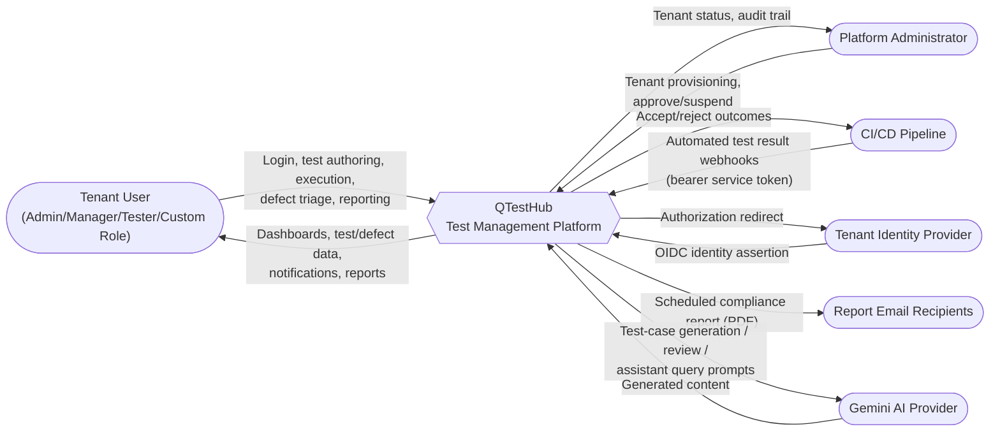
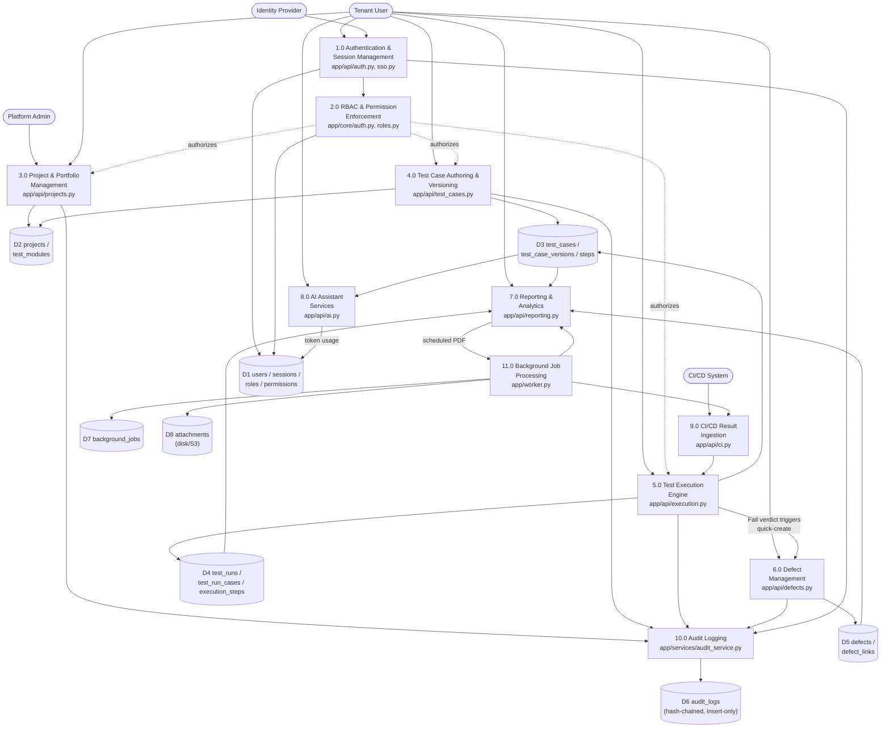
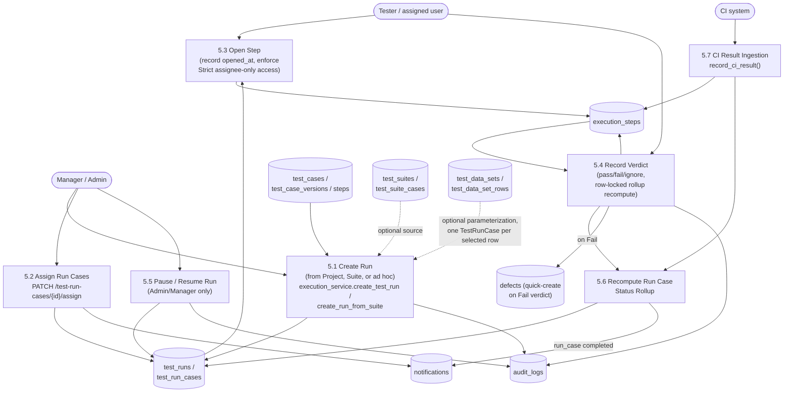
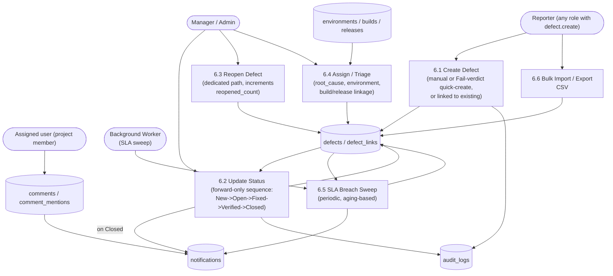
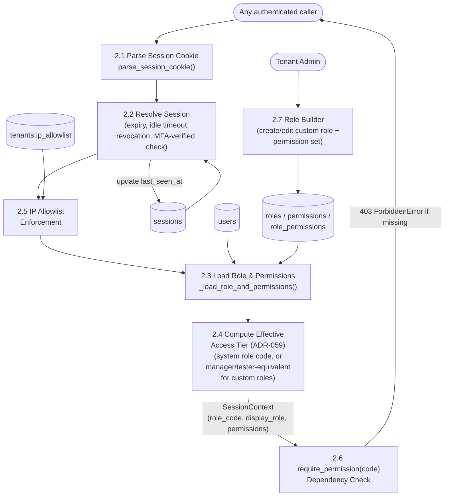
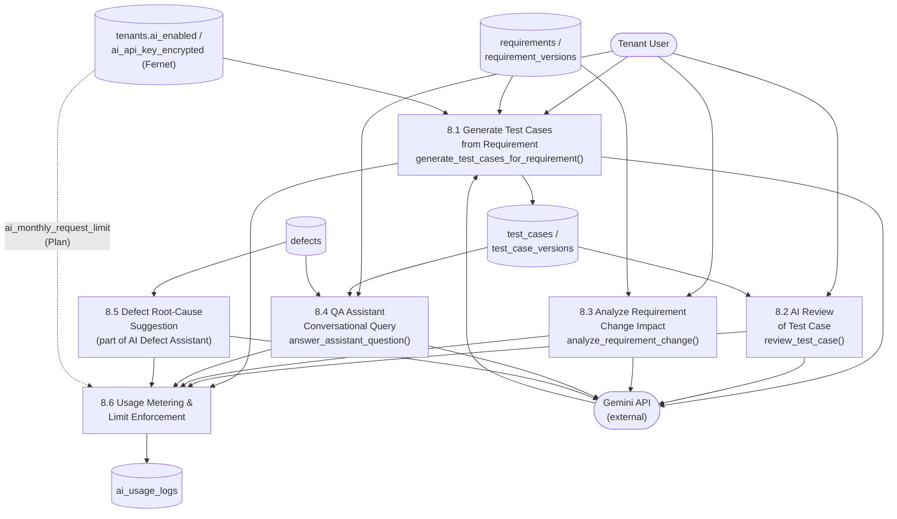

# Data Flow Diagrams (DFD)

**Purpose**: trace how data moves between external entities, processes, and data stores, at increasing levels of detail.
**Scope**: Level 0 (whole-system context), Level 1 (application-wide process map), Level 2 (per-module detail for Test Execution, Defect Management, RBAC/Auth, and AI Assistant Services — the four modules judged most structurally significant; Project/Test-Case-Authoring and Reporting flows are covered at Level 1 granularity and in the Sequence Diagrams document instead of a dedicated Level 2, to avoid near-duplicate diagrams).

## Level 0 — Context Diagram

**Diagram source**: [`diagrams/dfd-level0.mmd`](diagrams/dfd-level0.mmd)

**External entities**: Tenant User, Platform Administrator, CI/CD Pipeline, Tenant Identity Provider, Report Email Recipients, Gemini AI Provider. **Observation**: QTestHub has exactly one inbound unauthenticated-but-stateful entry point (SSO callback) and one fully machine-to-machine entry point (CI webhook) — both are deliberately separate from the human session-cookie plane.

## Level 1 — Application Data Flow

**Diagram source**: [`diagrams/dfd-level1.mmd`](diagrams/dfd-level1.mmd)

**Key observation**: Process 2.0 (RBAC) is a cross-cutting authorization gate on nearly every other process rather than a standalone feature — modeled here with dashed "authorizes" edges into 3.0/4.0/5.0 to avoid implying it's a sequential pipeline stage. Process 10.0 (Audit Logging) is similarly cross-cutting: every mutating process writes to the same insert-only, hash-chained store.

## Level 2 — Test Execution Module

**Diagram source**: [`diagrams/dfd-level2-execution.mmd`](diagrams/dfd-level2-execution.mmd)
**Source code**: `backend/app/api/execution.py`, `backend/app/services/execution_service.py`

**Technical observation**: 5.6 (rollup recompute) is drawn as a distinct process because it is a genuine shared sub-routine (`_recompute_run_case_status`) invoked from two independent entry points — human verdict recording (5.4) and automated CI ingestion (5.7) — and a real concurrency bug was once found and fixed exactly at this convergence point (two concurrent verdicts on different steps of the same run case corrupting the rollup; fixed with `SELECT ... FOR UPDATE`).

## Level 2 — Defect Management Module

**Diagram source**: [`diagrams/dfd-level2-defects.mmd`](diagrams/dfd-level2-defects.mmd)
**Source code**: `backend/app/api/defects.py`, `backend/app/services/defect_service.py`

**Technical observation**: status update (6.2) is deliberately forward-only (ADR-026) — reopening (6.3) is modeled as a separate process because it is implemented as a distinct code path (`defect_service.reopen_defect`) rather than a reverse transition of 6.2, preserving the forward-only invariant everywhere else in the state machine.

## Level 2 — RBAC / Authentication Module

**Diagram source**: [`diagrams/dfd-level2-rbac.mmd`](diagrams/dfd-level2-rbac.mmd)
**Source code**: `backend/app/core/auth.py`, `backend/app/api/roles.py`, `backend/app/services/role_service.py`

## Level 2 — AI Assistant Services Module

**Diagram source**: [`diagrams/dfd-level2-ai.mmd`](diagrams/dfd-level2-ai.mmd)
**Source code**: `backend/app/api/ai.py`, `backend/app/services/ai_service.py`, `backend/app/core/ai/`

**Technical observation**: every AI sub-process converges on 8.6 (usage metering) before returning to the caller — `ai_usage_logs` records both successful and failed calls (`success: bool` column), so usage auditing works even when the provider call itself fails. The tenant's AI API key is Fernet-decrypted in memory per-call and never logged or returned in any API response.

## Not Identified in Current Implementation

- A dedicated Level 2 DFD for Reporting/Analytics was not produced separately — its data flows (aggregation across `test_cases`/`defects`/`execution_steps`, scheduled PDF generation) are fully covered by Level 1 Process 7.0/11.0 and by the Scheduled Report sequence diagram; a standalone Level 2 would have substantially duplicated that content.
- External tracker sync (Jira/GitHub/GitLab) data flows are **not shown** — per `docs/KNOWN_GAPS.md`, this integration was explicitly declined/deferred by the user during a prior phase of this engagement and no corresponding code path exists to diagram.
