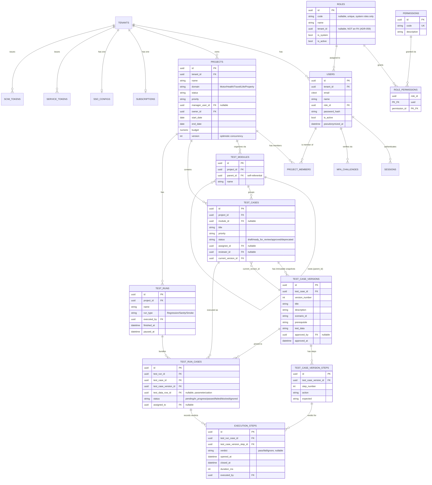

# Entity Relationship Diagram (ERD)

**Purpose**: a complete, source-verified map of every table, primary/foreign key, and relationship in the QTestHub schema.
**Scope**: all ~40 tables defined across `backend/app/models/` (27 files, every one read in full for this documentation pass) and confirmed against the Alembic migration history (`backend/alembic/versions/`, 40 migration files at time of writing). Split into 3 diagrams for readability — Core (identity/project/test authoring/execution), Defects & Requirements & Traceability, and Platform/Auth-planes/SaaS/AI/Jobs — rather than one unreadable 40-table diagram.

No table or column in this document was invented; every entity below corresponds to an actual SQLAlchemy model class. Nullability/constraint notes reflect the model's actual `CheckConstraint`/`UniqueConstraint`/`nullable=` declarations.

## Diagram 1 — Core: Identity, Project, Test Authoring, Execution

**Diagram source**: [`diagrams/erd-core.mmd`](diagrams/erd-core.mmd)



**Cardinality notes**:
- `TEST_CASES }o--|| TEST_CASE_VERSIONS` (current_version_id) is a circular FK pair, resolved via `use_alter=True` in the migration (a test case always has at least one version once created, but the version table references the test case it belongs to, and the test case references its "current" version back).
- `TEST_RUN_CASES` has a 3-column unique constraint `(test_run_id, test_case_id, test_data_row_id)` — Postgres treats NULL as distinct, so an unparameterized case keeps its original "can't be bundled twice" guarantee while a parameterized case gets exactly one row per selected data row (Pass 5 design).
- `ROLES.tenant_id` is deliberately **not** a real foreign key (see model docstring) — a real FK would make `TRUNCATE tenants CASCADE` wipe every system role along with it; validated service-side instead.

## Diagram 2 — Defects, Requirements, Traceability, Collaboration

**Diagram source**: [`diagrams/erd-defects-reqs.mmd`](diagrams/erd-defects-reqs.mmd)

```mermaid
erDiagram
    PROJECTS ||--o{ DEFECTS : "has"
    TEST_CASES ||--o{ DEFECTS : "originates (nullable)"
    TEST_CASE_VERSIONS ||--o{ DEFECTS : "pins version (nullable)"
    TEST_RUNS ||--o{ DEFECTS : "found in (nullable)"
    TEST_CASE_VERSION_STEPS ||--o{ DEFECTS : "failed step (nullable)"
    TEST_MODULES ||--o{ DEFECTS : "groups (nullable)"
    USERS ||--o{ DEFECTS : "reported_by"
    USERS ||--o{ DEFECTS : "assigned_to (nullable, project members only)"
    ENVIRONMENTS ||--o{ DEFECTS : "found in"
    BUILDS ||--o{ DEFECTS : "found_in_build_id"
    RELEASES ||--o{ DEFECTS : "fixed_in_release_id"
    DEFECTS ||--o{ DEFECT_LINKS : "relates_to/duplicate_of/caused_by"

    PROJECTS ||--o{ REQUIREMENTS : "has"
    REQUIREMENTS ||--o{ REQUIREMENT_VERSIONS : "immutable snapshots"
    REQUIREMENTS }o--|| REQUIREMENT_VERSIONS : "current_version_id"
    REQUIREMENTS ||--o{ REQUIREMENT_TEST_CASE_LINKS : "traced by (RTM)"
    TEST_CASES ||--o{ REQUIREMENT_TEST_CASE_LINKS : "covers"

    PROJECTS ||--o{ BUILDS : "has"
    PROJECTS ||--o{ RELEASES : "has"
    PROJECTS ||--o{ TEST_PLANS : "has"
    RELEASES ||--o{ TEST_PLANS : "optional release link"
    TEST_PLANS ||--o{ TEST_PLAN_RUNS : "groups"
    TEST_RUNS ||--o{ TEST_PLAN_RUNS : "belongs to plan"

    PROJECTS ||--o{ TEST_SUITES : "has (flat, reusable selections)"
    TEST_SUITES ||--o{ TEST_SUITE_CASES : "contains"
    TEST_CASES ||--o{ TEST_SUITE_CASES : "referenced by"

    TEST_CASES ||--o{ TEST_DATA_SETS : "parameterizes"
    TEST_DATA_SETS ||--o{ TEST_DATA_SET_ROWS : "has rows"
    TEST_DATA_SET_ROWS ||--o{ TEST_RUN_CASES : "drives execution of"

    PROJECTS ||--o{ SHARED_STEPS : "has reusable step library"

    USERS ||--o{ COMMENTS : "authors (polymorphic: test_case/defect/execution_step)"
    COMMENTS ||--o{ COMMENT_MENTIONS : "mentions"
    USERS ||--o{ COMMENT_MENTIONS : "mentioned"
    USERS ||--o{ NOTIFICATIONS : "receives"
    USERS ||--o{ ATTACHMENTS : "uploads (polymorphic owner)"

    DEFECTS {
        uuid id PK
        uuid project_id FK
        string title
        string severity "tenant-configurable via FIELD_OPTIONS"
        string priority "tenant-configurable via FIELD_OPTIONS"
        string status "New/Open/Fixed/Verified/Closed, forward-only"
        string root_cause "nullable, fixed taxonomy"
        int reopened_count
        datetime sla_breach_notified_at
    }
    DEFECT_LINKS {
        uuid id PK
        uuid defect_id FK
        string linkable_type "execution_step/test_case/defect"
        uuid linkable_id
        string link_type "relates_to/duplicate_of/caused_by"
    }
    REQUIREMENTS {
        uuid id PK
        uuid project_id FK
        string title
        uuid current_version_id FK
    }
    REQUIREMENT_VERSIONS {
        uuid id PK
        uuid requirement_id FK
        int version_number
        string title
        string description
    }
    REQUIREMENT_TEST_CASE_LINKS {
        uuid requirement_id FK
        uuid test_case_id FK
        uuid linked_by FK
    }
    TEST_SUITES {
        uuid id PK
        uuid project_id FK
        string name
        string description
    }
    TEST_SUITE_CASES {
        uuid test_suite_id FK
        uuid test_case_id FK
    }
    TEST_PLANS {
        uuid id PK
        uuid project_id FK
        uuid release_id FK "nullable"
        string name
    }
    TEST_PLAN_RUNS {
        uuid test_plan_id FK
        uuid test_run_id FK
    }
    TEST_DATA_SETS {
        uuid id PK
        uuid test_case_id FK
        string name
    }
    TEST_DATA_SET_ROWS {
        uuid id PK
        uuid test_data_set_id FK
        string name
        json data "free-form key-value"
    }
    SHARED_STEPS {
        uuid id PK
        uuid project_id FK
        string name
        string action
        string expected
        string category
    }
    COMMENTS {
        uuid id PK
        string owner_type "test_case/defect/execution_step"
        uuid owner_id
        string body
        uuid author_id FK
    }
    NOTIFICATIONS {
        uuid id PK
        uuid recipient_id FK
        string type "8 fixed trigger types"
        string entity_type
        uuid entity_id
        datetime read_at
    }
    ENVIRONMENTS {
        uuid id PK
        string name
    }
    BUILDS {
        uuid id PK
        uuid project_id FK
        string name
        date built_at
    }
    RELEASES {
        uuid id PK
        uuid project_id FK
        string name
        date release_date
    }
```



**Design notes**:
- `TEST_SUITES` (flat, reusable, cross-module selection) is explicitly distinct from `TEST_MODULES` (hierarchical, structural organization) and from `TEST_PLANS` (groups multiple **runs**, not test cases). All three exist simultaneously and serve different purposes — this was a deliberate three-way distinction made during Pass 5 of this engagement, not an accidental overlap.
- `SHARED_STEPS` is a copy-on-insert template library: inserting a shared step into a test case's version copies its current `action`/`expected` text at that moment. Editing the library entry afterward never retroactively changes a test case that already copied from it — this preserves the immutable-version-snapshot model exactly.
- `NOTIFICATIONS.type` is a fixed, closed enum of 8 values (`mention`, `test_case_assigned`, `defect_closed`, `review_requested`, `review_decided`, `run_case_assigned`, `test_run_completed`, `defect_sla_breach`) — deliberately not a generic configurable-rules engine.
- `DEFECTS.assigned_to` is restricted at the service layer to users already assigned to the defect's project (confirmed product decision: "Defect assignee = Project-assigned users only").

## Diagram 3 — Platform, Auth Planes, SaaS/Billing, AI, Background Jobs

**Diagram source**: [`diagrams/erd-platform-auth.mmd`](diagrams/erd-platform-auth.mmd)

```mermaid
erDiagram
    PLATFORM_ADMINS ||--o{ AUDIT_LOGS : "attributed actions (platform_admin_id)"
    USERS ||--o{ AUDIT_LOGS : "attributed actions (user_id)"
    SERVICE_TOKENS ||--o{ AUDIT_LOGS : "attributed actions (service_token_id)"
    TENANTS ||--o{ AUDIT_LOGS : "scoped to"

    TENANTS ||--o| SUBSCRIPTIONS : "has one"
    PLANS ||--o{ SUBSCRIPTIONS : "assigned"

    TENANTS ||--o{ USER_INVITES : "invites"
    ROLES ||--o{ USER_INVITES : "pre-assigns role"

    TENANTS ||--o{ FIELD_OPTIONS : "configures severity/priority labels"
    TENANTS ||--o{ STATUS_LABELS : "configures status display overrides"
    TENANTS ||--o{ CUSTOM_FIELD_DEFINITIONS : "defines extra fields"
    CUSTOM_FIELD_DEFINITIONS ||--o{ CUSTOM_FIELD_VALUES : "has values (polymorphic owner)"

    TENANTS ||--o{ AI_USAGE_LOGS : "meters AI calls"
    USERS ||--o{ AI_USAGE_LOGS : "triggers"
    REQUIREMENTS ||--o{ AI_USAGE_LOGS : "optionally for"

    TENANTS ||--o{ BACKGROUND_JOBS : "queues (RLS-exempt, worker scans all tenants)"
    USERS ||--o{ BACKGROUND_JOBS : "created_by"

    TENANTS ||--o{ REPORT_SCHEDULES : "configures"
    USERS ||--o{ REPORT_SCHEDULES : "created_by"

    TENANTS ||--o{ IDEMPOTENCY_KEYS : "scoped to"
    USERS ||--o{ IDEMPOTENCY_KEYS : "scoped to"

    PLATFORM_ADMINS {
        uuid id PK
        citext email UK
        string password_hash
        smallint failed_login_count
        datetime locked_until
    }
    TENANTS {
        uuid id PK
        string name
        string status "pending/approved/suspended"
        bool ai_enabled
        string ai_provider "gemini"
        string ai_api_key_encrypted "Fernet ciphertext"
        string brand_display_name
        string brand_primary_color
        string brand_logo_ref
        array ip_allowlist "CIDR strings, nullable"
        string data_region
    }
    ROLES {
        uuid id PK
        string code "nullable, system roles only"
        uuid tenant_id "nullable, NOT FK (ADR-059)"
        bool is_system
    }
    AUDIT_LOGS {
        uuid id PK
        uuid tenant_id FK
        uuid user_id FK "nullable, one of 3 actor planes"
        uuid platform_admin_id FK "nullable"
        uuid service_token_id FK "nullable"
        string action
        string entity_type
        uuid entity_id
        jsonb event_metadata
        string prev_hash
        string record_hash
    }
    SSO_CONFIGS {
        uuid id PK
        uuid tenant_id FK UK
        bool enabled
        string issuer
        string client_id
        string client_secret_encrypted
        string default_role_code
    }
    SCIM_TOKENS {
        uuid id PK
        uuid tenant_id FK
        string token_hash
        datetime revoked_at
    }
    SERVICE_TOKENS {
        uuid id PK
        uuid tenant_id FK
        string name
        string token_hash
        string scope "ci_results"
        datetime revoked_at
    }
    PLANS {
        uuid id PK
        string code UK
        int seat_limit "nullable=unlimited"
        int storage_limit_mb
        int ai_monthly_request_limit
    }
    SUBSCRIPTIONS {
        uuid id PK
        uuid tenant_id FK UK
        uuid plan_id FK
        string status "trialing/active/past_due/canceled"
        int seat_count
        datetime current_period_end
    }
    USER_INVITES {
        uuid id PK
        uuid tenant_id FK
        citext email
        uuid role_id FK
        string token_hash
        datetime expires_at
        datetime accepted_at
    }
    FIELD_OPTIONS {
        uuid id PK
        uuid tenant_id FK
        string field_key "defect_severity/test_case_priority/defect_priority"
        string code
        string label
        string color
    }
    STATUS_LABELS {
        uuid id PK
        uuid tenant_id FK
        string entity_type "test_case/defect"
        string status_code
        string label
    }
    CUSTOM_FIELD_DEFINITIONS {
        uuid id PK
        uuid tenant_id FK
        string entity_type "test_case/defect/requirement"
        string field_key
        string field_type "text/number/boolean/date/select/multi_select"
        json options
        bool required
    }
    CUSTOM_FIELD_VALUES {
        uuid id PK
        uuid field_definition_id FK
        string owner_type
        uuid owner_id
        json value
    }
    AI_USAGE_LOGS {
        uuid id PK
        uuid tenant_id FK
        uuid user_id FK
        string provider
        string action
        int total_tokens
        bool success
    }
    BACKGROUND_JOBS {
        uuid id PK
        uuid tenant_id FK
        string job_type
        jsonb payload
        string status "queued/running/succeeded/failed"
        smallint attempts
        jsonb result
    }
    REPORT_SCHEDULES {
        uuid id PK
        uuid tenant_id FK
        string report_type "compliance"
        string cadence "daily/weekly/monthly"
        array recipient_emails
        bool enabled
        datetime last_run_at
    }
    IDEMPOTENCY_KEYS {
        uuid id PK
        uuid tenant_id FK
        uuid user_id FK
        string scope
        string key
        uuid entity_id
    }
```

**Design notes**:
- `AUDIT_LOGS` is the one table with **three** nullable actor FKs (`user_id`, `platform_admin_id`, `service_token_id`) — exactly one is ever populated per row, modeling three deliberately separate, non-overlapping identity planes (ADR-008 for platform admins, this engagement's CI/CD pass for service tokens). It is insert-only and hash-chained (`prev_hash`/`record_hash`); the application database role has UPDATE/DELETE revoked on this table at the grant level, not just by convention.
- `PLANS`/`SUBSCRIPTIONS` are schema-and-admin-assignment only — confirmed scope decision during this engagement ("Schema + UI only, no real payments"), no payment gateway integration exists.

## RLS-exempt tables (and why)

A small, explicitly-documented set of tables do **not** carry PostgreSQL Row-Level Security, because the row itself must be resolved before any tenant context can exist:

| Table | Reason |
|---|---|
| `sessions` | A session cookie carries only an opaque session id — its `tenant_id` is discovered by looking the row up, not known in advance (ADR-015). |
| `mfa_challenges` | Same reasoning — resolved via `session_id` before a tenant context exists. |
| `user_invites` | `POST /users/invite/{token}/accept` is a public endpoint; the invite's own `tenant_id` must be resolved from the unguessable token before any tenant context is set. |
| `background_jobs` | The worker process must scan for the next queued job **across all tenants** before any tenant context can be set for that specific row; every tenant-facing read is still explicitly filtered by `tenant_id == ctx.tenant_id` at the service layer. |

All other tenant-owned tables carry `TenantScopedMixin` and are RLS-protected.

## Not Identified in Current Implementation

- A dedicated "billing transactions / invoices" table does not exist — confirmed scope decision: `PLANS`/`SUBSCRIPTIONS` are schema-and-UI only, no real payment processor integration.
- No SAML-specific tables exist (`SSO_CONFIGS` is OIDC-only) — SAML was explicitly declined/skipped as a scope decision during this engagement.
- No dedicated GDPR "erasure request" or "retention policy" table exists yet — only `users.pseudonymized_at` (see `PROCESS_FLOW_DIAGRAMS.md` §6).
