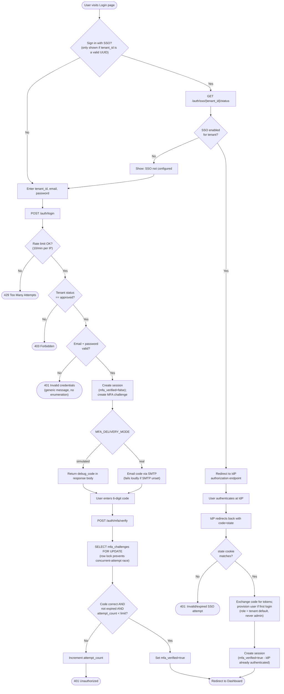
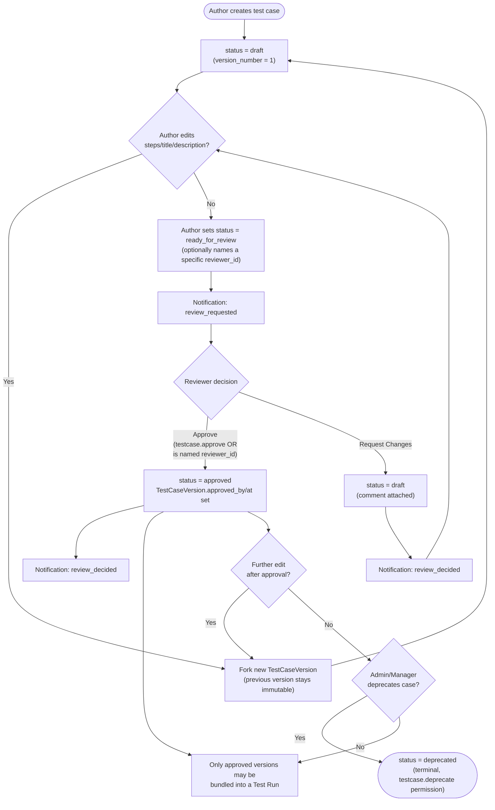
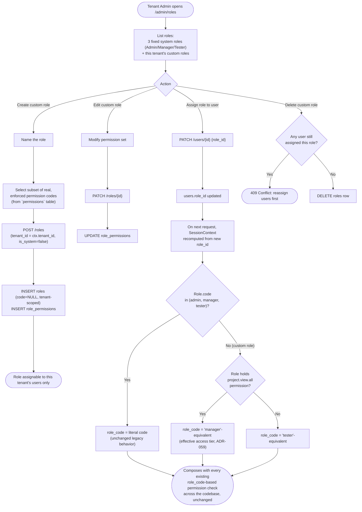
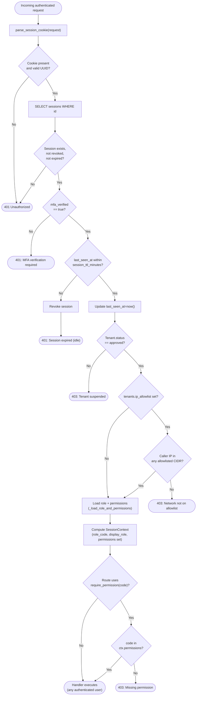
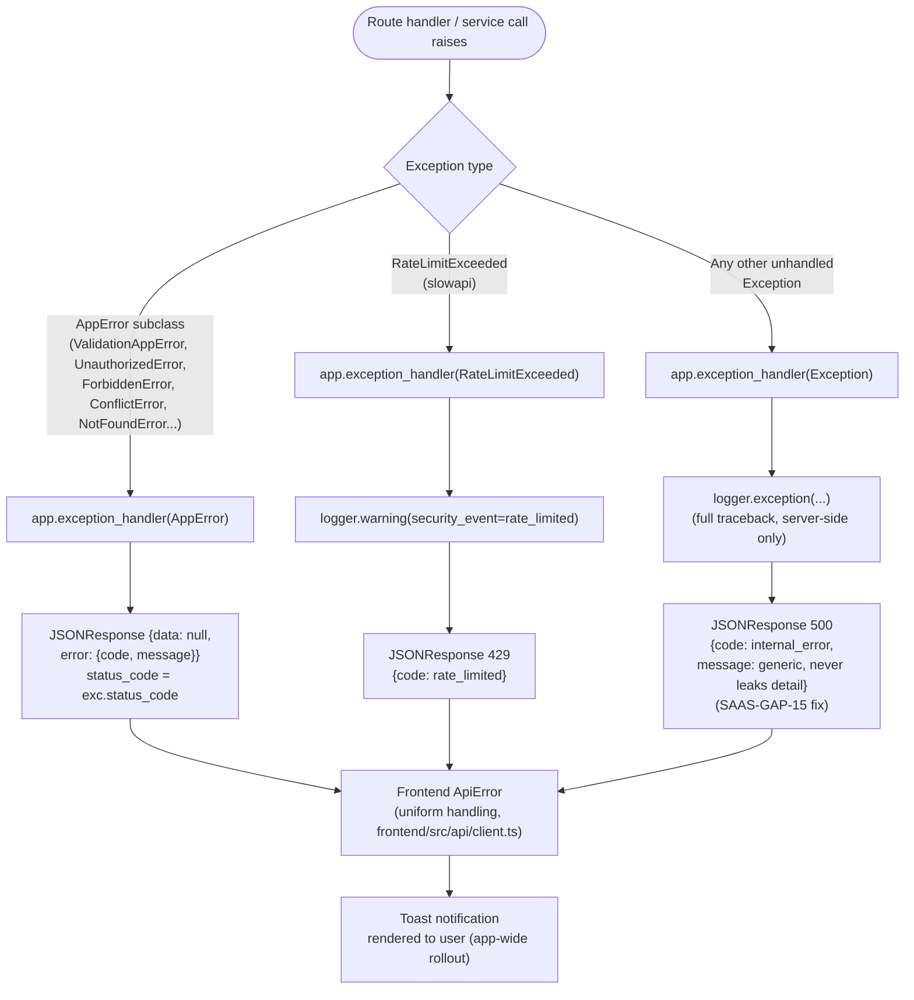
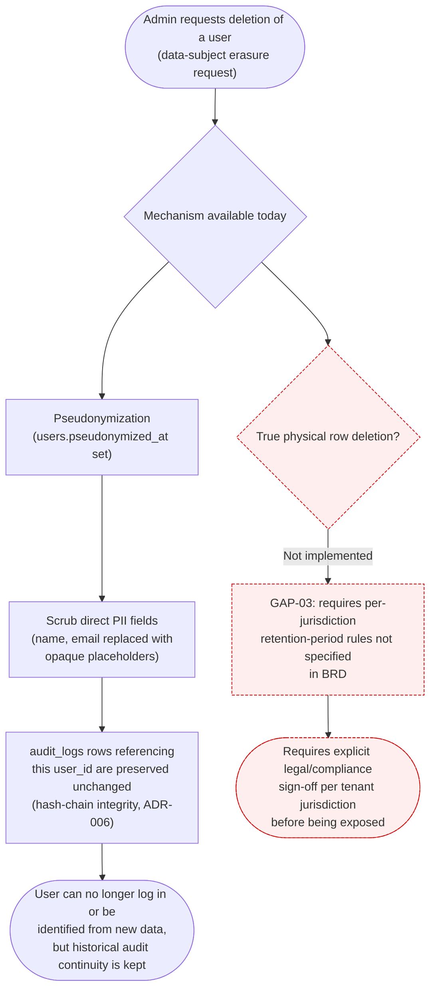

# Flowcharts / Process Flow Diagrams

**Purpose**: show decision points, validations, and alternative/error paths for the workflows where branching logic — not strict request/response sequencing — is the point of interest.
**Scope**: authentication (credentials + SSO branch + MFA), test case approval, role/permission management (role builder), the RBAC permission-check decision tree applied on every request, the application-wide error-handling pattern, and the GDPR/DPDP data-deletion flow (including its explicitly gated, not-yet-built branch).

## 1. Authentication (Login, SSO branch, MFA)

**Diagram source**: [`diagrams/flow-auth-login.mmd`](diagrams/flow-auth-login.mmd)
**Source**: `backend/app/api/auth.py`, `backend/app/api/sso.py`, `backend/app/services/auth_service.py`, `frontend/src/routes/Login.tsx`

**Validations shown**: rate limit, tenant status, credential match, state-cookie CSRF check, MFA code correctness/expiry/attempt budget. **Alternative paths**: SSO vs. credential login converge at "Dashboard" but SSO sessions skip the MFA branch entirely (the IdP is trusted to have already authenticated the user).

## 2. Test Case Approval Workflow

**Diagram source**: [`diagrams/flow-testcase-approval.mmd`](diagrams/flow-testcase-approval.mmd)
**Source**: `backend/app/services/test_case_service.py`, `backend/app/models/test_case.py`

**Technical observation**: `deprecated` is terminal — re-deprecating an already-deprecated case returns 409 (GAP-36), and there is no path back from `deprecated` to any other status in the current implementation.

## 3. Role & Permission Management (Role Builder)

**Diagram source**: [`diagrams/flow-rbac-role-builder.mmd`](diagrams/flow-rbac-role-builder.mmd)
**Source**: `backend/app/api/roles.py`, `backend/app/services/role_service.py`, `backend/app/core/auth.py` (ADR-059/060)

**Design rationale** (ADR-059/060, confirmed with the user during this engagement): rather than rewriting ~20 hardcoded `role_code == "..."` comparisons across 7 service files, a custom role's effective access tier is *computed* once per request and carried on `SessionContext.role_code` — every pre-existing check composes correctly without modification. **Disclosed limitation**: dozens of frontend conditionals keyed on the literal role name (`role === 'admin'`) do not visually recognize a custom role as admin-equivalent even when its permission set grants equivalent access — backend enforcement is correct regardless; this is a UI-display-only gap (see `docs/KNOWN_GAPS.md` GAP-05).

## 4. RBAC Permission-Check Decision Flow

**Diagram source**: [`diagrams/flow-permission-check.mmd`](diagrams/flow-permission-check.mmd)
**Source**: `backend/app/core/auth.py` (`get_current_context`, `require_permission`)

**Notes**: this exact chain runs on **every** authenticated request (it is a FastAPI dependency, not a one-time login check) — suspending a tenant mid-session blocks it on the very next request, not just new logins (GAP-23). `trust_proxy_headers` must be explicitly enabled for `X-Forwarded-For` to be honored in the IP-allowlist check, specifically to prevent a client from spoofing its own IP when no reverse proxy is actually in front of the app.

## 5. Error / Exception Handling Pattern

**Diagram source**: [`diagrams/flow-error-handling.mmd`](diagrams/flow-error-handling.mmd)
**Source**: `backend/app/core/errors.py`, `backend/app/main.py` (3 exception handlers)

**Notes**: every error path converges on the same `{data, error: {code, message}}` response envelope (`backend/app/core/responses.py`'s `envelope()` helper mirrored on the error side), which is what allows the frontend's `ApiError` class to handle every error uniformly regardless of origin.

## 6. GDPR / DPDP Data Deletion

**Diagram source**: [`diagrams/flow-gdpr-deletion.mmd`](diagrams/flow-gdpr-deletion.mmd)
**Source**: `backend/app/models/identity.py` (`users.pseudonymized_at`), `docs/KNOWN_GAPS.md` GAP-03

**Status — Not Identified in Current Implementation / Requires Clarification**: the "technical capability, flagged as pending legal sign-off" version of full physical erasure discussed during a later phase of this engagement (Pass 6 of the then-current 8-pass plan) had not yet been built as of the last code state this documentation pass analyzed — the red-dashed branch above reflects the repository's actual current state (pseudonymization only), not the forward plan. Confirm against `backend/app/services/` for a `gdpr_service.py` or equivalent before asserting otherwise in any future revision of this document.

## Not Identified in Current Implementation

- An "approval workflow" flowchart for **Defects** (equivalent to the Test Case approval flowchart above) was not produced as a separate diagram — defect status transitions are fully covered by the Defect Lifecycle sequence diagram (`SEQUENCE_DIAGRAMS.md` §5), which already shows the forward-only state sequence and its branches; a second flowchart would have been largely redundant.
- A dedicated CI pipeline / quality-gate flowchart (lint/typecheck/test/build order) is **not covered here** — this package documents the deployed application's own runtime behavior, not its development/CI tooling.
