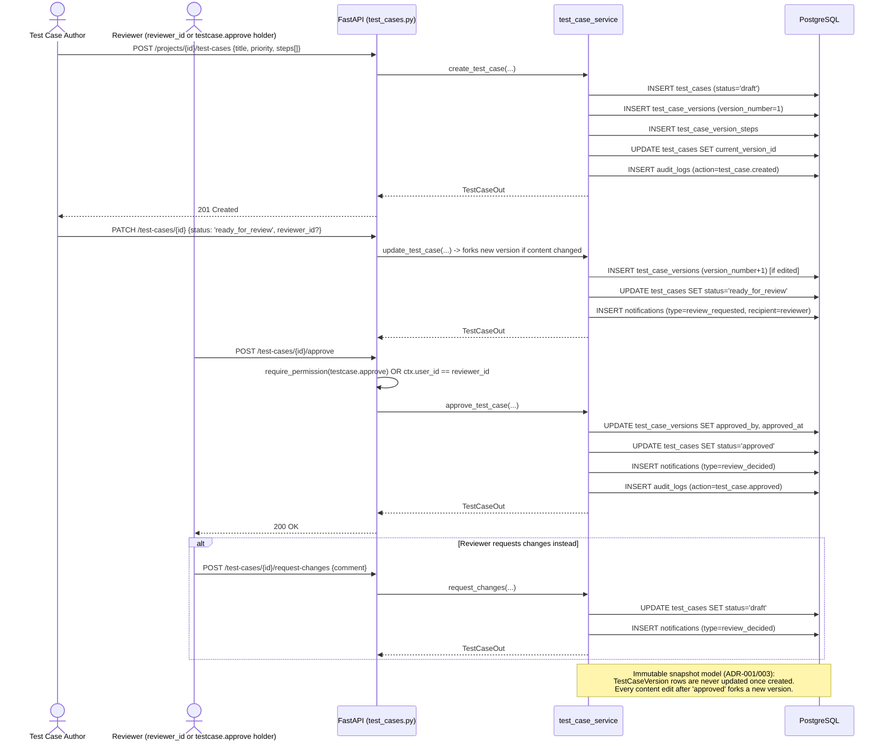
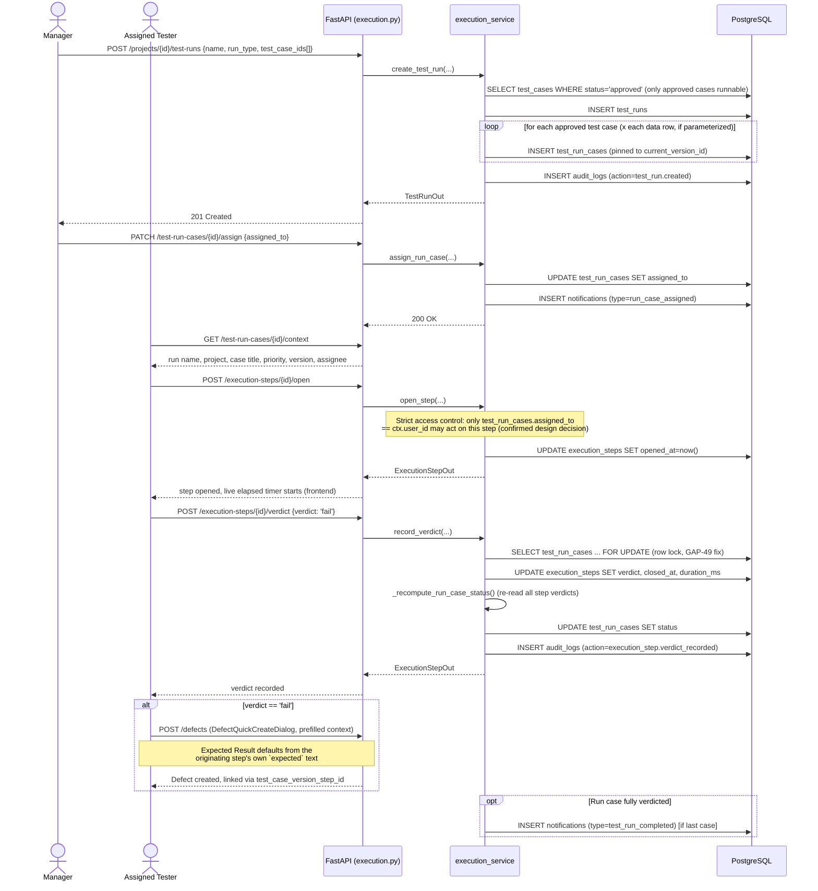
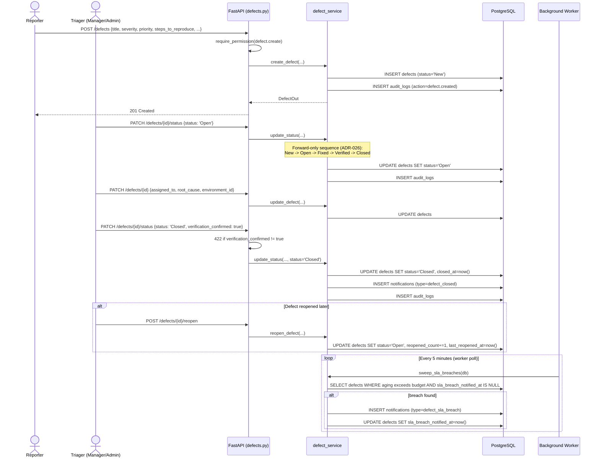
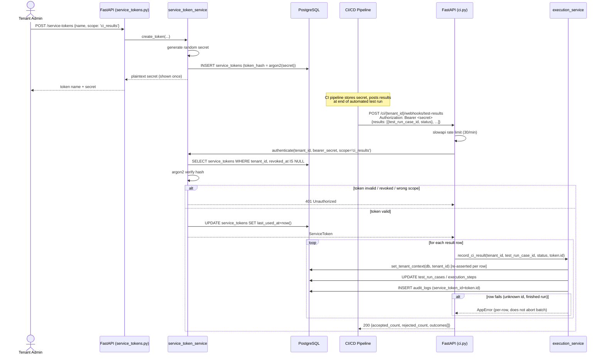
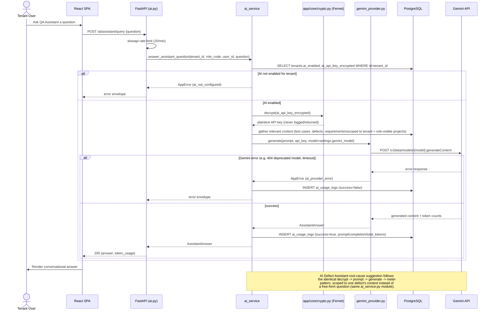
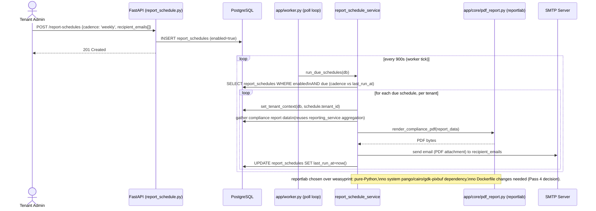

# Sequence Diagrams

**Purpose**: show the real request/response/DB-interaction order for the major workflows, including authentication checks, error branches, and background-process interleaving.
**Scope**: 9 workflows selected to cover every major module (auth, test authoring, execution, defects, CI/CD, AI, bulk data, reporting) and all three distinct auth planes.

## 1. Login + MFA

**Diagram source**: [`diagrams/seq-login-mfa.mmd`](diagrams/seq-login-mfa.mmd)
**Source**: `backend/app/api/auth.py` (`login`, `verify_mfa`), `backend/app/services/auth_service.py`, `backend/app/core/auth.py`, `frontend/src/routes/Login.tsx`

```mermaid
sequenceDiagram
    actor U as User (Browser)
    participant FE as React SPA (Login.tsx)
    participant API as FastAPI (auth.py)
    participant SVC as auth_service
    participant DB as PostgreSQL

    U->>FE: Enter tenant_id, email, password
    FE->>API: POST /api/v1/auth/login
    API->>API: slowapi rate limit check (10/min per IP)
    API->>SVC: start_login(tenant_id, email, password, request)
    SVC->>DB: SELECT tenants.status WHERE id=tenant_id
    alt tenant not approved
        SVC-->>API: 403 Forbidden (tenant suspended/pending)
        API-->>FE: error envelope
    else tenant approved
        SVC->>DB: SELECT users WHERE tenant_id, email
        alt invalid credentials
            SVC-->>API: 401 Unauthorized (generic, no enumeration - ADR-017)
        else valid credentials
            SVC->>DB: INSERT sessions (mfa_verified=false)
            SVC->>DB: INSERT mfa_challenges (code_hash, expires_at)
            Note over SVC: MFA_DELIVERY_MODE=simulated:<br/>code returned in response.<br/>=real: emailed via SMTP (app/core/mfa.py)
            SVC-->>API: session_row, debug_code (simulated only)
            API-->>FE: Set-Cookie qth_session; {mfa_required:true, debug_code?}
        end
    end
    FE->>U: Show MFA code entry screen
    U->>FE: Enter 6-digit code
    FE->>API: POST /api/v1/auth/mfa/verify {code}
    API->>SVC: verify_mfa(session_id, code)
    SVC->>DB: SELECT mfa_challenges ... FOR UPDATE
    alt code incorrect / expired / attempt_count exceeded
        SVC->>DB: increment attempt_count
        SVC-->>API: 401 Unauthorized
    else code correct
        SVC->>DB: UPDATE sessions SET mfa_verified=true
        SVC->>DB: UPDATE mfa_challenges SET verified_at=now()
        SVC-->>API: session_row
        API-->>FE: Set-Cookie qth_session (refreshed); {verified:true}
    end
    FE->>API: GET /api/v1/auth/me
    API->>API: get_current_context (parse cookie, resolve SessionContext)
    API-->>FE: user, tenant_id, role, permissions[]
    FE->>U: Redirect to Dashboard
```

**Notes**: the `SELECT ... FOR UPDATE` row lock on the MFA challenge (GAP-17) closes a race where concurrent verify attempts could each read the same pre-increment `attempt_count`. Rate limiting is keyed by client IP (not `(tenant_id, email)`), a deliberate simplification documented in `docs/KNOWN_GAPS.md` GAP-16.

## 2. Tenant SSO (OIDC Authorization Code Flow)

**Diagram source**: [`diagrams/seq-sso-oidc.mmd`](diagrams/seq-sso-oidc.mmd)
**Source**: `backend/app/api/sso.py`, `backend/app/services/sso_service.py`

```mermaid
sequenceDiagram
    actor U as User (Browser)
    participant FE as React SPA (Login.tsx)
    participant API as FastAPI (sso.py)
    participant SVC as sso_service
    participant DB as PostgreSQL
    participant IdP as Tenant Identity Provider

    U->>FE: Enter tenant_id (UUID), click "Sign in with SSO"
    FE->>API: GET /api/v1/auth/sso/{tenant_id}/status
    API->>SVC: is_enabled(tenant_id)
    SVC->>DB: SELECT sso_configs WHERE tenant_id
    API-->>FE: {enabled: true/false}
    alt SSO enabled
        FE->>U: window.location.href = /auth/sso/{tenant_id}/login (full redirect)
        U->>API: GET /api/v1/auth/sso/{tenant_id}/login
        API->>SVC: get_config(tenant_id); build_authorization_url()
        API->>API: generate random state, set httponly qth_sso_state cookie
        API-->>U: 302 Redirect to IdP authorization_endpoint
        U->>IdP: Authenticate (IdP's own login UI)
        IdP-->>U: 302 Redirect to /auth/sso/{tenant_id}/callback?code&state
        U->>API: GET /api/v1/auth/sso/{tenant_id}/callback?code&state
        API->>API: validate state cookie == state param
        API->>SVC: exchange_code_and_provision(tenant_id, code, redirect_uri)
        SVC->>IdP: POST token_endpoint (exchange code for tokens)
        IdP-->>SVC: id_token / access_token
        SVC->>DB: SELECT users WHERE tenant_id, email (from id_token claims)
        alt user does not exist
            SVC->>DB: INSERT users (role = sso_configs.default_role_code, tester by default)
        end
        SVC->>DB: INSERT sessions (mfa_verified=true - IdP already authenticated)
        SVC-->>API: session_row
        API-->>U: Set-Cookie qth_session; 302 Redirect to "/"; delete qth_sso_state
        U->>FE: Load SPA at "/"
        FE->>API: GET /api/v1/auth/me
        API-->>FE: session context
    else SSO not enabled
        FE->>U: "SSO is not configured for this organization"
    end
```

**Notes**: SSO-provisioned users are never auto-granted admin — `default_role_code` defaults to `tester`. The CSRF-style `state` cookie is `httponly`/`samesite=lax` with a 600-second max age.

## 3. Test Case Creation, Versioning & Approval

**Diagram source**: [`diagrams/seq-testcase-approval.mmd`](diagrams/seq-testcase-approval.mmd)
**Source**: `backend/app/api/test_cases.py`, `backend/app/services/test_case_service.py`



## 4. Test Run Creation & Step-by-Step Execution

**Diagram source**: [`diagrams/seq-test-execution.mmd`](diagrams/seq-test-execution.mmd)
**Source**: `backend/app/api/execution.py`, `backend/app/services/execution_service.py`, `frontend/src/routes/execution/ExecutionConsole.tsx`



**Notes**: access control here is **Strict** per an explicit product decision made during this engagement (`execution access = "Strict: assigned-to-them only"`) — a tester who is not `test_run_cases.assigned_to` cannot act on that case's steps at all, not even to view-only.

## 5. Defect Creation and Status Lifecycle

**Diagram source**: [`diagrams/seq-defect-lifecycle.mmd`](diagrams/seq-defect-lifecycle.mmd)
**Source**: `backend/app/api/defects.py`, `backend/app/services/defect_service.py`



## 6. CI/CD Webhook Result Ingestion (M2M Auth Plane)

**Diagram source**: [`diagrams/seq-ci-webhook.mmd`](diagrams/seq-ci-webhook.mmd)
**Source**: `backend/app/api/ci.py`, `backend/app/core/service_token_auth.py`, `backend/app/services/service_token_service.py`



**Notes**: `set_tenant_context` is re-asserted per row because the Postgres session-scoped GUC resets on every commit/rollback — a recurring bug class across this codebase, documented and fixed everywhere it was found.

## 7. AI QA Assistant Query / AI Defect Assistant Root-Cause Suggestion

**Diagram source**: [`diagrams/seq-ai-assistant.mmd`](diagrams/seq-ai-assistant.mmd)
**Source**: `backend/app/api/ai.py`, `backend/app/services/ai_service.py`, `backend/app/core/ai/gemini_provider.py`, `backend/app/core/crypto.py`



## 8. CSV Bulk Import (Flexible Field-Mapping Flow)

**Diagram source**: [`diagrams/seq-csv-bulk-import.mmd`](diagrams/seq-csv-bulk-import.mmd)
**Source**: `backend/app/api/csv_import.py`, `backend/app/services/csv_import_service.py`

```mermaid
sequenceDiagram
    actor U as Tenant User
    participant FE as React SPA (ImportDialog.tsx)
    participant API as FastAPI (csv_import.py)
    participant SVC as csv_import_service
    participant DB as PostgreSQL

    U->>FE: Select CSV file, optionally choose a tool preset\n(TestRail/Zephyr/Jira)
    FE->>API: POST /test-cases/import/detect-columns?preset=testrail (file)
    API->>API: validate extension/.csv, size <= csv_import_max_bytes, UTF-8 decode
    API->>SVC: detect_columns(csv_text, preset)
    SVC->>SVC: parse header + sample rows,\nfuzzy-match to a suggested column mapping
    SVC-->>API: {headers, sample_rows, suggested_mapping}
    API-->>FE: 200 OK (nothing written to DB yet)
    FE->>U: Show mapping confirmation UI (editable)

    U->>FE: Confirm/adjust mapping, submit
    FE->>API: POST /test-cases/import/mapped (file, mapping JSON)
    API->>API: require_permission(testcase.bulk_import_export)
    API->>SVC: import_test_cases_mapped(tenant_id, role_code, user_id, csv_text, mapping)
    SVC->>SVC: materialize all rows up front;\nreject whole file if rows > csv_import_max_rows (2000)
    SVC->>DB: preload existing (project_id, title_lower) pairs
    loop for each row
        SVC->>SVC: validate required fields, detect in-batch duplicate title
        alt row invalid or duplicate
            SVC->>SVC: record row error (does not abort batch)
        else row valid
            SVC->>DB: INSERT test_cases, test_case_versions, steps
        end
    end
    SVC->>DB: INSERT audit_logs (action=test_case.bulk_imported)
    SVC-->>API: ImportReport {created_count, errors[]}
    API-->>FE: 200 OK
    FE->>U: Show results; "Download Error Report (CSV)" if any errors
```

**Notes**: the TestRail/Zephyr/Jira preset mappings are fuzzy-matched suggestions, explicitly labeled in the UI as unverified against a real export from those tools (no real accounts/files were available in this environment to validate against).

## 9. Scheduled / Emailed Compliance PDF Report

**Diagram source**: [`diagrams/seq-scheduled-report.mmd`](diagrams/seq-scheduled-report.mmd)
**Source**: `backend/app/api/report_schedule.py`, `backend/app/services/report_schedule_service.py`, `backend/app/core/pdf_report.py`, `backend/app/worker.py`



## Not Identified in Current Implementation

- A SCIM provisioning sequence diagram was not produced — `scim.py`/`scim_service.py` are real, routed code, but were not independently re-verified end-to-end as part of this documentation pass, so a diagram would risk asserting detail not freshly confirmed against the current code.
- GDPR physical-erasure and WORM audit-log-shipping sequences do not exist because the underlying features do not exist yet (see `PROCESS_FLOW_DIAGRAMS.md`'s GDPR flowchart and `docs/KNOWN_GAPS.md` GAP-01/GAP-03).
