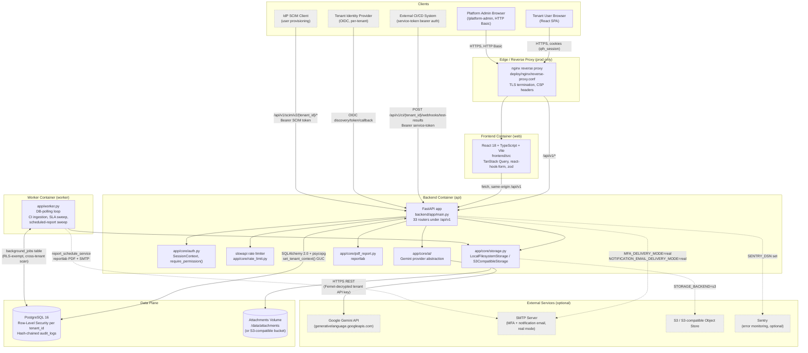

# System Architecture Diagram

**Diagram source**: [`diagrams/system-architecture.mmd`](diagrams/system-architecture.mmd)
**Purpose**: show every runtime component, how they communicate, and which integrations are optional vs. load-bearing.
**Scope**: container-level (Docker Compose services) and the clients/external systems that talk to them. Does not descend into individual classes — see the ERD and Sequence Diagrams documents for that level of detail.

## Diagram

## Component descriptions

| Component | Source | Notes |
|---|---|---|
| React SPA | `frontend/src/` (Vite, TypeScript, TanStack Query, react-hook-form + zod, Tailwind-based UI primitives under `frontend/src/components/ui/`) | Built and served by the `web` container (`frontend/Dockerfile`); in prod sits behind nginx. |
| FastAPI app | `backend/app/main.py` | Registers 33 routers (see table below), 3 custom exception handlers, CORS + correlation-id + request-logging middleware, slowapi rate-limit middleware, optional Sentry init gated by `settings.sentry_enabled`. |
| `app/core/auth.py` | Session/MFA/RBAC resolution | `SessionContext` dataclass, `get_current_context`, `require_permission()`/`require_any_permission()` FastAPI dependencies, IP-allowlist enforcement (`_enforce_ip_allowlist`). |
| `app/core/ai/` | Gemini provider abstraction | `gemini_provider.py` builds `{gemini_api_base_url}/v1beta/models/{gemini_model}:generateContent` calls; model name centrally configured in `app/core/config.py` (`gemini_model` setting, overridable via `GEMINI_MODEL` env var without a code change — this is exactly how the mid-engagement Gemini model-deprecation incident was resolved). |
| `app/core/pdf_report.py` | reportlab-based PDF rendering | Chosen over `weasyprint` specifically because it is pure-Python with no system `pango`/`cairo`/`gdk-pixbuf` dependency chain, avoiding any Dockerfile change. |
| `app/core/storage.py` | Pluggable attachment storage | `LocalFilesystemStorage` (default) or `S3CompatibleStorage` (`STORAGE_BACKEND=s3`), same interface, swapped purely at the service layer (ADR-053). |
| `app/worker.py` | Background job polling loop | Same container image as `api`, different entrypoint/command. Runs three independent timers in one process: job-queue claim loop (CSV import jobs), a 300s SLA-breach sweep, and a 900s scheduled-report sweep. |
| PostgreSQL 16 | `db` service | Row-Level Security policies applied per tenant-scoped table (migration-defined); hash-chained, insert-only `audit_logs` with UPDATE/DELETE grants revoked for the application role (`qtesthub_app`) — only the owner role (used for migrations only) can alter schema. |
| Attachments volume | `qtesthub_attachments` Docker volume, mounted into both `api` and `worker` | Bytes never stored as DB blobs (ADR-012); metadata lives in the `attachments` table. |

## Routers registered (`backend/app/main.py`, all under `/api/v1`)

`platform`, `auth`, `users`, `projects`, `test_cases`, `csv_import`, `execution`, `defects`, `reporting`, `audit`, `attachments`, `comments`, `notifications`, `settings`, `requirements`, `ai`, `test_assets`, `test_modules`, `search`, `export`, `sso` (+ `sso.admin_router`), `scim` (+ `scim.admin_router`), `field_customization`, `templates`, `test_data`, `service_tokens`, `roles`, `ci`, `report_schedule`, `shared_steps`, `test_data_sets`, `test_suites`, `test_plans`.

## Deployment topology — dev vs. prod

- **Dev** (`docker-compose.yml`): `db` port 5432 exposed to host for direct inspection; `api`/`web` built with no reverse proxy, `web` served by Vite's own dev server on port 5173; no TLS. Named volumes: `qtesthub_pgdata`, `qtesthub_attachments`.
- **Prod** (`docker-compose.prod.yml`): explicit Compose `name: qtesthub-prod` (added after a real Tier-0 incident where an unnamed prod teardown wiped the dev stack's volumes) — critical operational note: `docker compose -f docker-compose.prod.yml down -v` must never be run against a directory where the dev compose file could also resolve to the same project name. `db` has **no host port mapping** — reachable only from other containers on the compose network. `api` requires `CORS_ALLOW_ORIGINS`, `AI_CREDENTIAL_ENCRYPTION_KEY`, and database credentials with no insecure defaults (`${VAR:?...}` substitutions refuse to start the container if unset); `MFA_DELIVERY_MODE`/`NOTIFICATION_EMAIL_DELIVERY_MODE` default to `real` in prod (vs. `simulated` in dev). `app/core/config.py::validate_for_production()` additionally fails the application at import time (before serving a single request) if `ENVIRONMENT=production` and any of: MFA still simulated, `DATABASE_URL` still the dev default, or CORS still unset/wildcarded.
- **Reverse proxy** (`deploy/nginx/reverse-proxy.conf`, prod only): TLS termination, Content-Security-Policy headers (added during the localStorage/XSS security-hardening pass), routes `/api/v1/*` to `api`, everything else to `web`.
- **Health checks**: `api` and `web` have HTTP-based health checks (`/api/v1/ready` does a real `SELECT 1` round-trip, distinct from the liveness-only `/api/v1/health` — SAAS-GAP-16 fix). `worker` has a `/proc`-scanning health check instead (it serves no HTTP endpoint at all — Docker's default inherited HTTP healthcheck from the shared image always failed for this container until this was fixed).

## Technical observations

- **Optional vs. load-bearing externals**: Gemini (AI features), SMTP (only required when either MFA or notification delivery mode is `real`), S3 (only when `STORAGE_BACKEND=s3`), and Sentry (purely additive error monitoring) are all designed to degrade gracefully when unconfigured — each follows the same "empty config value means feature is off, not broken" convention (`ai_credential_encryption_key`, `smtp_host`, `sentry_dsn` all default to `""`).
- **No cache/broker layer exists in this stack** (no Redis, no Celery) — this is a deliberate, documented constraint (see `app/core/rate_limit.py`'s own comment) that shaped both the background-job design (DB-backed queue, not a message broker) and the rate limiter (in-process `slowapi`, which means rate limits are per-process and would need a Redis-backed limiter to hold correctly across a horizontally-scaled multi-process deployment — **Requires Clarification** if horizontal scaling of the `api` service is ever planned).
- **SCIM** is registered and reachable (`scim.router`, `scim.admin_router`) but was not independently re-verified as part of this documentation pass; it is included here because it is real, routed code, not a planned/future item.
