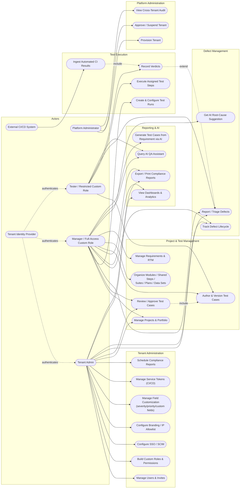
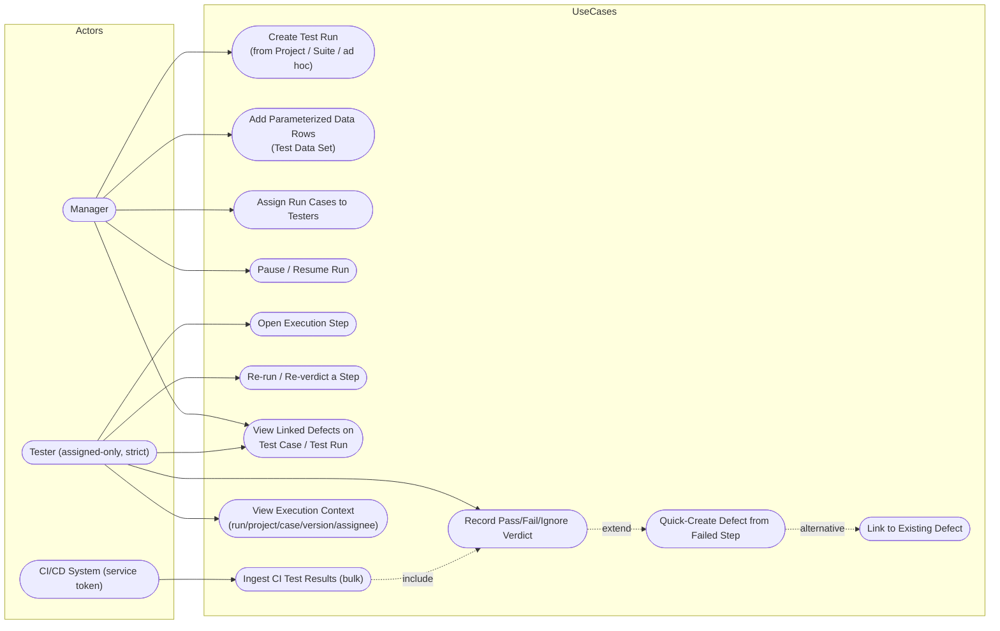

# Use Case Diagrams

**Purpose**: map each actor to the capabilities they actually have, sourced from real `require_permission()`/`require_any_permission()` gates and router definitions, not an idealized feature list.
**Scope**: a system-wide overview covering every major module, plus one module-level detail diagram (Test Execution & Defects) chosen because it has the richest actor/permission interplay (strict assignee-only execution access, project-membership-gated defect assignment, a distinct machine actor for CI ingestion).

**Note on notation**: Mermaid has no native UML use-case diagram shape. Both diagrams below are modeled as a `flowchart` using stadium shapes (`(["..."])`) for use cases and actor-style nodes for actors, with `-.include.->`/`-.extend.->`/`-.alternative.->` labeled dashed edges standing in for UML's `<<include>>`/`<<extend>>` relationships. This is a deliberate, disclosed substitution, not a claim of native UML rendering.

## Overview — Actors × Major Modules

**Diagram source**: [`diagrams/usecase-overview.mmd`](diagrams/usecase-overview.mmd)

### Actor descriptions

| Actor | Source | Description |
|---|---|---|
| Platform Administrator | `backend/app/models/identity.py::PlatformAdmin`, `backend/app/api/platform.py` | Bootstrap-only (ADR-008); authenticates via HTTP Basic against a table entirely separate from tenant RBAC. Not part of any tenant's permission model. |
| Tenant Admin | `roles.code == "admin"` (system role) | Full tenant-scope access: user/role management, all integration configuration, all project/test/defect capabilities. |
| Manager / Full-Access Custom Role | `roles.code == "manager"`, or a custom role holding `project.view.all` (computed effective tier, ADR-059) | Project-wide visibility and test-run creation authority; cannot manage tenant-level settings (SSO/roles/service tokens) unless the custom role explicitly grants those permission codes too. |
| Tester / Restricted Custom Role | `roles.code == "tester"`, or a custom role without `project.view.all` | Can author test cases and execute **only** run cases explicitly assigned to them (confirmed "Strict" access decision) — cannot create runs, approve test cases, or manage users. |
| External CI/CD System | `service_tokens` bearer auth | Machine actor; its only capability is posting automated test results to one scoped webhook endpoint. |
| Tenant Identity Provider | OIDC, per-tenant `sso_configs` | Authenticates users on the tenant's behalf; not an "actor" with QTestHub capabilities of its own, but shown because it initiates a real use case (SSO login) from outside the system. |

### Use case descriptions (selected, non-obvious ones)

- **Build Custom Roles & Permissions** (UC5): the role-builder capability (ADR-059/060) — a Tenant Admin can define a role with any subset of real, enforced permission codes; the 3 system roles remain fixed and always available.
- **Ingest Automated CI Results** (UC19) `<<include>>` **Record Verdicts** (UC18): a CI result is recorded through the identical `record_verdict`/rollup-recompute code path a human tester's verdict uses — modeled as an include relationship because it is literally the same underlying operation, authenticated differently.
- **Record Verdicts** (UC18) `<<extend>>` **Report / Triage Defects** (UC20): recording a `fail` verdict optionally extends into the defect quick-create flow — it is a conditional continuation, not a mandatory step (a tester may close the failed step without creating a defect, or link to an existing one instead).
- **Review / Approve Test Cases** (UC13) `<<include>>` **Author & Version Test Cases** (UC12): approval always acts on an already-authored version; it cannot exist independently.

## Detail — Test Execution & Defect Module

**Diagram source**: [`diagrams/usecase-execution-defects.mmd`](diagrams/usecase-execution-defects.mmd)

**Why this module gets its own detail diagram**: it has the richest, most security-relevant actor/permission interplay in the system — a Manager creates and configures runs but a Tester can only act on steps explicitly assigned to them (not merely "any step in a project they belong to" — a deliberately **Strict** design confirmed during this engagement), and a wholly separate machine actor (CI/CD, bearer-token authenticated) can perform the same underlying "record a verdict" action through a completely different authentication path.

## Not Identified in Current Implementation

- No distinct "Customer / External Stakeholder (read-only)" actor exists in the current RBAC model — every authenticated identity in the system is one of the three system roles or a tenant-defined custom role; there is no concept of an external, un-provisioned read-only viewer (e.g., a client-facing report-only link).
- SCIM's actor (an IdP's SCIM client provisioning users automatically) is shown in the System Architecture diagram's client list but was not given its own use-case entries here, since its provisioning behavior was not independently re-verified as part of this documentation pass (see `SEQUENCE_DIAGRAMS.md`'s equivalent disclosure).
